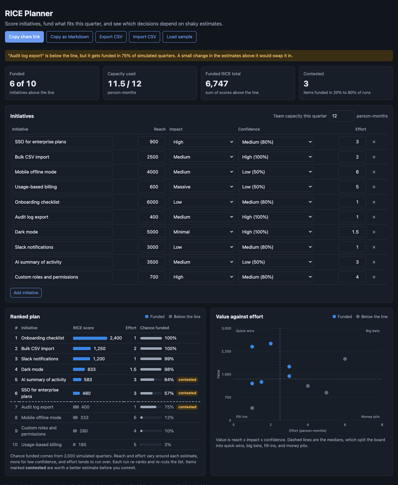

# RICE Planner

A browser tool for quarterly roadmap planning. Score initiatives with RICE, fund what fits the team's capacity, and see which funding decisions would flip if the estimates are a little off.



## Why

RICE (reach x impact x confidence / effort) is a good way to make prioritization explicit. The usual spreadsheet stops there: sort by score, draw a line where capacity runs out, done. But every number in it is a guess. Two items with scores of 480 and 400 are not really different, and which one lands above the line can depend on a rounding choice.

This tool keeps the simple RICE workflow and adds the question a planning review should ask: **how sure are we about the line?**

## What it does

- **Editable list** of initiatives with reach, impact, confidence, and effort in person-months, using the standard RICE scales.
- **Ranked plan with a cut line.** It walks down the ranked list and funds each item that still fits. Items that don't fit are skipped, so smaller items below them can still make it. That is how teams actually fill a quarter.
- **Chance funded.** 2,000 simulated quarters vary reach and effort around each estimate, with a wider spread for low-confidence items and a skew toward effort running over. Each run re-ranks and re-cuts the list. Items funded in 20% to 80% of runs are marked **contested**.
- **A warning when the line is fragile.** In the sample, "Audit log export" sits below the line but gets funded in 75% of simulated quarters, more often than two items above it. That is a cheap item worth a second look before the plan is final.
- **Value against effort.** A scatter plot split at the medians into quick wins, big bets, fill-ins, and money pits, with a tooltip on each point.
- **Import and export.** CSV in and out, column order doesn't matter, and confidence can be `0.8` or `80%`. "Copy as Markdown" gives a table ready for a planning doc.
- **Sharing.** The whole plan lives in the URL. It is also kept in the browser, so a refresh doesn't lose work.

The simulation uses a seeded random generator, so the same plan always gives the same percentages.

## Run it

It is a static site with no build step and no dependencies.

- **GitHub Pages:** enable Pages for the repo and serve from the root of the default branch.
- **Locally:** ES modules need a web server, so `file://` will not work. From this folder run:

```bash
python3 -m http.server 8000
```

Then open http://localhost:8000.

## Tests

The scoring, cut line, simulation, CSV, and sharing logic live in `src/rice.js` with no DOM code, so they run under Node's built-in test runner.

```bash
npm test
```

14 tests cover the score, tie-breaking, the cut line skipping an item that doesn't fit, quadrants, a reproducible simulation, sure winners and sure losers, CSV quoting and error messages, and the URL round-trip with Unicode names.

## License

MIT. See [LICENSE](LICENSE).
